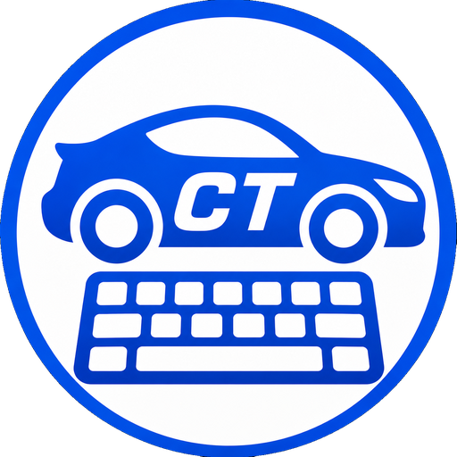
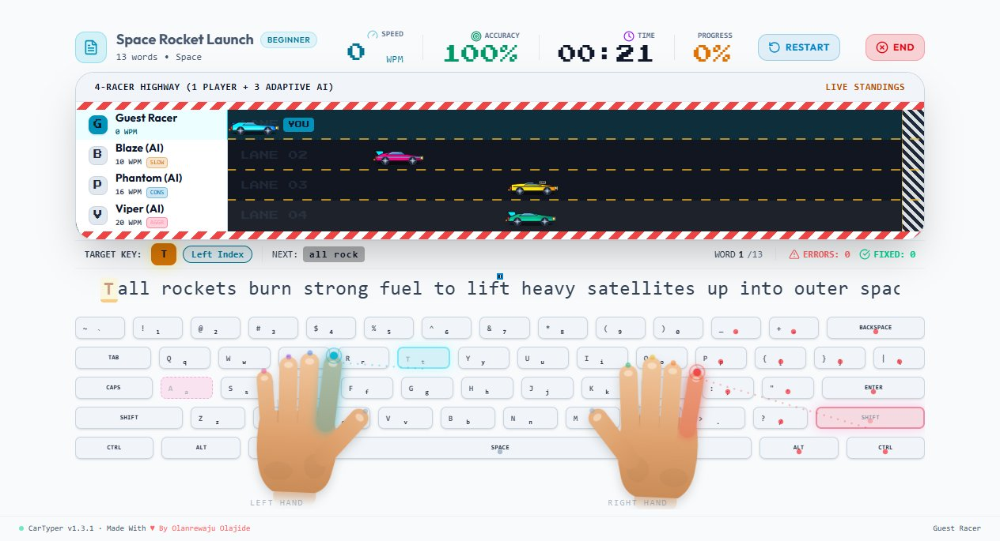

  

<h1 align="center">CarTyper</h1>

  <strong>Type fast. Race hard.</strong> 
  A retro arcade typing race for the classroom — free, and it works offline.

  <a href="https://github.com/monyasau/car-typer/releases/download/latest/CarTyper-setup.exe"><strong>Download for Windows</strong></a>
  ·
  <a href="https://github.com/monyasau/car-typer/releases">Releases</a>
  ·
  <a href="https://github.com/monyasau/car-typer/issues">Report an issue</a>

## What is CarTyper?

CarTyper turns typing practice into a race. Every correct keystroke pushes your
car forward; a mistake stalls it until you fix it. Students race adaptive AI
opponents, earn coins, and spend them on cars and upgrades for their garage.

- **Race adaptive AI** — up to 9 rivals with their own personalities
- **Lessons, drills & 300+ passages** — three difficulty levels
- **Garage & shop** — 21 cars plus paints, rims, and exhaust trails, bought with coins earned by racing (purely cosmetic)
- **Progress tracking** — WPM, accuracy, most-missed keys, a typing heatmap, achievements, and streaks
- **Teacher mode** — password-protected student management, reports, and printable certificates
- **Local-first** — no cloud accounts; student data stays on the device, with one-file backup and restore

## Get it

| | Windows app | Browser version |
| --- | --- | --- |
| **How** | [Download the installer](https://github.com/monyasau/car-typer/releases/download/latest/CarTyper-setup.exe) (v1.6.2, ~121 MB) | Open the site and press **Play online** |
| **Best for** | School computer labs | Trying it out, Macs, Chromebooks |
| **Operating system** | Windows 10 or later | Windows, macOS, ChromeOS, or Linux |
| **Memory** | 1 GB RAM minimum | — |
| **Disk space** | ~150 MB | Nothing to install |
| **Internet** | Only to download | Only to open the page |
| **Keyboard** | Physical keyboard required | Physical keyboard required |

> **"Windows protected your PC"?** The installer isn't code-signed yet, so
> SmartScreen warns about it. Click **More info → Run anyway**.
>
> **Installing on a whole lab?** Run `CarTyper-setup.exe /S` for a silent
> per-user install, or `CarTyper-setup.exe /S /allusers` (as admin) for every
> account on the PC.

## Frequently asked questions

**Is it free?**
Yes. There are no in-app purchases — coins are earned only by racing.

**Does it need the internet?**
No. The Windows app works fully offline once installed. The browser version
only needs a connection to open the page.

**Where is student data stored?**
On the device. The Windows app keeps it in each Windows user's profile
(`%APPDATA%\CarTyper`); the browser version keeps it in that browser's storage.
To move everything to another computer, use **Backup → Export** in the app and
import the file on the other machine.

**Does it need admin rights?**
No — it installs for the current Windows user by default. Installing for all
users on a PC needs admin.

**Does it work on Macs, Chromebooks, or tablets?**
Yes, through the browser version. A physical keyboard is required.

## Get help

Found a bug or have a question? [Open an issue](https://github.com/monyasau/car-typer/issues).

---

Made with ♥ by Olanrewaju Olajide

